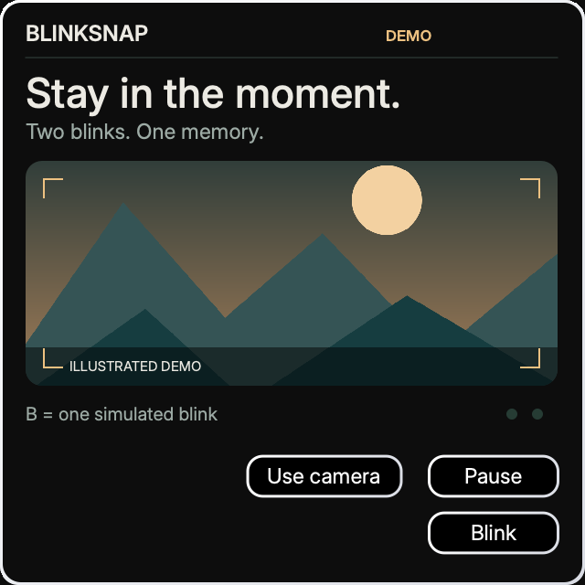
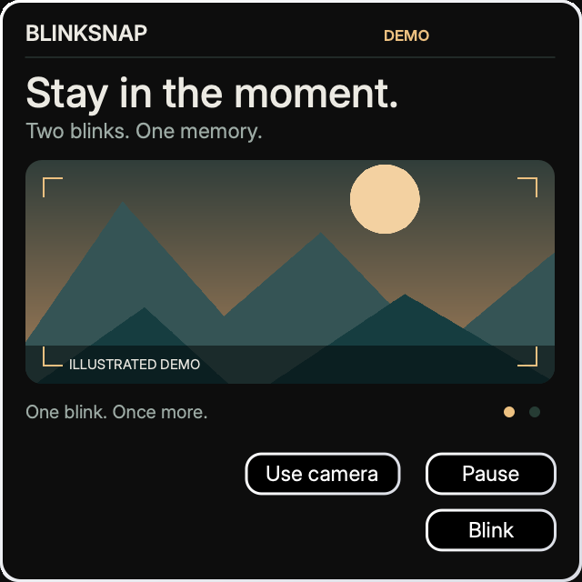
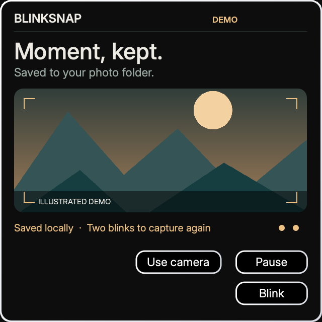
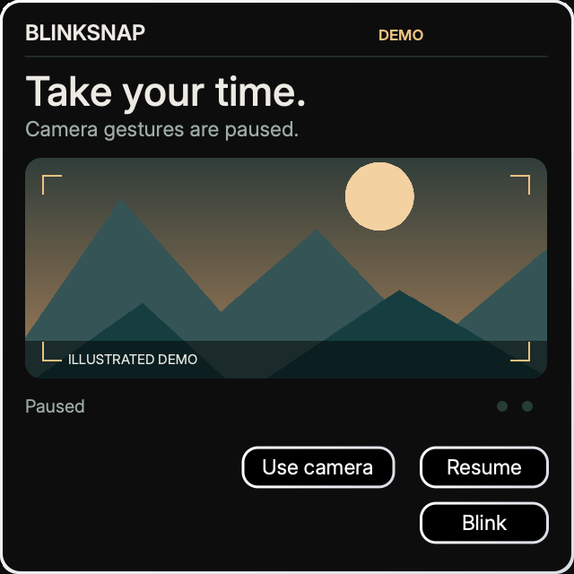

# BlinkSnap

**Two blinks. One memory.**

A hands-free camera concept for Raven Prism. Two short losses of eye tracking, each followed by recovery, release the shutter. A quiet amber indicator acknowledges the first blink, and a photo preview confirms the capture.



[Watch the English-narrated simulator demo](media/demo.mp4)

The narrated demo uses Cartesia narration and actual application frames with simulated input.

## Try it

Python 3.12 is recommended. Install Git and Python, then run these commands from this repository.

```sh
git clone https://github.com/srcJin/raven-blink-snap.git
cd raven-blink-snap
python3.12 -m venv .venv
git clone https://github.com/RavenResonance/raven-framework.git
.venv/bin/python -m pip install -e ./raven-framework
./run.sh
```

The app opens in the Raven simulator. It starts with an original illustrated demo scene. Press **B** once, wait about a quarter of a second, then press **B** again. Each press simulates a single 130 ms tracking loss. The on-screen **Blink** button does the same thing. Two blinks save a JPEG under `~/Pictures/Raven BlinkSnap/`.

- **Pause / Resume** controls whether gestures can release the shutter.
- **Use camera** switches to the Raven camera API. On desktop, this accesses the webcam and may require OS permission. The camera opens only when a capture is triggered and closes after the operation.
- **Use demo** returns to the illustrated scene. Demo files have a `demo-` filename prefix.
- Set `BLINKSNAP_DIR` to choose another photo directory.

### On Raven hardware

```sh
export RAVEN_APP_ID='your-app-id'
export RAVEN_APP_KEY='your-app-key'
.venv/bin/python main.py --device
```

Raven hardware is detected automatically. The explicit `--device` option polls `EyeControl.get_gaze_position()` instead of synthesizing losses. Select **Use camera** to enable actual photography. Sensor entitlement and deployment credentials may be required by Raven. To package with the framework deployment command, use `.venv/bin/python main.py --device deploy`.

**Hardware validation is pending.** The SDK exposes a gaze coordinate or `None`; it does not expose a verified blink event here. `None` can also mean a sensor error or tracking failure. This is a timing heuristic, and its thresholds need real-device evaluation. The simulator demo demonstrates application behavior and synthetic input. It is not footage captured on Raven Prism.

## Interaction design

The interface uses a black waveguide-friendly background, warm amber confirmation, large type, and a compact control cluster on the right. The scene is explicitly labeled as a demo. Real camera mode leaves the viewfinder unobstructed until a photo exists. Capture feedback appears immediately, and camera I/O runs outside the UI thread.

| State | Behavior |
| --- | --- |
| Ready | Wait for stable tracking and the first short loss |
| One blink | Show one amber dot while waiting for the second blink |
| Capturing | Ignore further gestures and disable mode changes |
| Saved | Show the image and confirm local storage |
| Paused | Ignore blink input until resumed |
| Error | Show a retry instruction and re-arm the detector |





## Detection rules

`blink.py` has no GUI or sensor dependencies. Both the demo and device paths feed the same detector.

- Poll eye tracking every 20 ms.
- Require at least 50 ms of recovered tracking before a new loss.
- Accept losses lasting 70–350 ms.
- Require the second loss to begin within 650 ms of the first recovery.
- Apply a two-second cooldown after a capture trigger.
- Reset on long losses, very short glitches, insufficient recovery, backwards time, or a polling gap above 150 ms.
- Startup without valid tracking cannot create a blink.

Photos use unique filenames and an atomic temporary-file rename. Captures are local. The app does not upload photos.

## Verify and reproduce

```sh
.venv/bin/python -m unittest discover -s tests -v
.venv/bin/python capture_demo.py
```

`capture_demo.py` requires FFmpeg on PATH. It renders the real Qt app with a deterministic clock and simulated blink events, writes four PNG screenshots and a 34-second silent MP4, and asserts that exactly two photos were saved. Temporary demo photos are removed automatically. A persistent label identifies the video as a simulator demo.

The narration workflow uses Cartesia to produce English speech. The narration transcript is in `media/narration.txt`. Generate it with Node 20 or newer after rendering the silent video. Copy `.env.example` to a private `.env`, add your Cartesia key, then run `node narrate.mjs`. An external file is supported with `node narrate.mjs --env-file /path/to/private.env`. The script extends the last frame if the narration needs additional time. It uses the [Cartesia speech bytes API](https://docs.cartesia.ai/api-reference/tts/bytes).

## Project files

- `main.py` implements the Raven application, viewfinder, camera worker, and photo storage.
- `blink.py` implements the tracking-loss state machine.
- `tests/test_app.py` checks local storage, pause behavior, and recovery after a write failure.
- `tests/test_blink.py` covers two-blink capture, single blink, noise, prolonged loss, timing gaps, recovery, cooldown, startup loss, and a stalled poll loop.
- `capture_demo.py` produces the simulator media from the actual application.
- `media/` contains screenshots, narrated video, and narration text.

## License

Application code and the original illustrated demo scene are MIT licensed. Raven Framework is a separately installed proprietary dependency governed by its own license. Its source code is not included in this repository.
